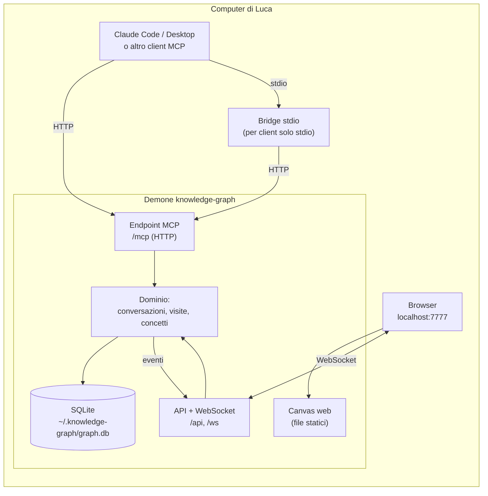

# Architettura di knowledge-graph

> Stato: architettura approvata il 2026-10-10 (D11). Sono implementati `kc_start`, `kc_track`, `kc_focus`, `kc_link`, gli strumenti di lettura `kc_recall`, `kc_tree`, `kc_profile`, la skill per Claude Code e la vista conversazione; il resto segue il piano al §9. Le decisioni di prodotto sono in DECISIONI.md del progetto.

## 1. Vincoli che guidano le scelte

- Locale, open source, installabile con un comando (RNF1–3).
- Qualunque client MCP deve poter scrivere e leggere (D6, RNF9).
- Il canvas si aggiorna in tempo reale mentre il modello scrive (RF11, RNF4).
- Nessuna chiave API o LLM lato server: l'intelligenza (titoli, riassunti, "è lo stesso concetto?") la mette il modello che chatta. Il server è un archivio veloce e stupido.

## 2. Forma del sistema: un solo processo locale



**Perché un demone unico** e non un server MCP stdio lanciato da ogni client: più client (Claude Code in due terminali, Desktop) e il canvas devono vedere **lo stesso grafo, in tempo reale**. Un processo unico che possiede il database e notifica il browser è il modo più semplice. Per i client che parlano solo stdio c'è un bridge minimo che inoltra al demone (avviandolo se non gira).

Alternativa scartata: ogni client avvia il suo server stdio e tutti scrivono sullo stesso file SQLite, con il canvas che osserva il file. Funziona, ma il tempo reale diventa polling e la logica si duplica.

## 3. Scelte tecnologiche

| Area | Scelta | Perché | Alternative |
|---|---|---|---|
| Linguaggio | **TypeScript su Node 22** | SDK MCP ufficiale maturo; stesso linguaggio per server e canvas; distribuzione con `npx`; coerente con LocalChat | Python + FastMCP (ottimo per MCP, ma due linguaggi e installazione meno immediata) |
| Server HTTP | **Fastify** | Leggero, già usato in LocalChat, WebSocket via plugin | Hono, Express |
| Persistenza | **SQLite** (WAL) + **FTS5** via `node:sqlite` | Un file = backup facile (RNF8); 10k concetti sono pochi; FTS5 per ricerca e concetti simili | Neo4j (troppo pesante per un tool locale), DB a grafo embedded (ecosistema fragile) |
| Somiglianza concetti (RF6) | **Lessicale** (FTS5 + nome normalizzato) | Zero dipendenze, decide comunque il modello | Embedding locali: in backlog se la lessicale non basta |
| Vista conversazione | **React + React Flow** con layout **ELK** gerarchico | Nodi HTML ricchi: tooltip con "Approfondisci" banale; ≤500 nodi fluidi | Cytoscape.js |
| Vista personale | **Sigma.js** (WebGL) + layout force | 10k nodi fluidi (RNF7) | Cytoscape.js (unica libreria per entrambe, ma lenta oltre qualche migliaio) |
| Tempo reale | **WebSocket**, eventi dal dominio | Latenza < 1 s (RNF4) | SSE |
| Distribuzione | **pacchetto npm**: `npx knowledge-graph` | Un comando (RNF2) | Binario singolo, Docker |
| Licenza | **MIT** | Permissiva, standard | Apache 2.0 |

## 4. Modello dati

```
conversations(id, title, client, started_at, last_activity_at)
concepts(id, name, name_norm UNIQUE, created_at, last_seen_at, visit_count)
visits(id, conversation_id, concept_id, parent_visit_id NULL, title, summary, excerpt NULL, seq, created_at)
concept_links(from_concept_id, to_concept_id, kind)      -- correlato, parte-di, ...
fts_concepts(name, summaries)                            -- FTS5 per ricerca e somiglianza
```

- **Albero della conversazione** = `visits` con `parent_visit_id`.
- **Collegamento tratteggiato** (D1) = due visite della stessa conversazione con lo stesso `concept_id`.
- **Grafo personale** = `concepts` + archi derivati dalle visite (genitore → figlio) + `concept_links`.
- Il **riassunto di un concetto** è la lista dei riassunti delle sue visite, più recente prima. Nessun LLM lato server.

## 5. Strumenti MCP (pochi e brevi, per il costo in token)

| Strumento | Fa | Requisiti |
|---|---|---|
| `kc_start(title?)` | Apre o riprende la conversazione, restituisce id e nodo corrente | RF1 |
| `kc_track(nodes[])` | **Batch**: crea una o più visite `{title, summary, parent: "current" \| id \| "root", excerpt?}`. Aggancia in automatico i concetti con nome uguale; restituisce gli id e al massimo 3 concetti simili per nodo | RF2, RF3, RF5, RF6 |
| `kc_focus(node_id)` | Torna su un nodo esistente (diventa il corrente) | RF4 |
| `kc_link(visit_id, concept_id)` | Conferma che una visita è un concetto già noto (unisce) | RF6 |
| `kc_recall(query)` | "Cosa sa già Luca di X?": concetti, riassunti, date | RF8 |
| `kc_tree(conversation_id?)` | Albero compatto di una conversazione | RF9 |
| `kc_profile()` | Temi più esplorati e recenti | RF10 |

Gli strumenti di lettura stanno in `src/core/reader.ts` (non scrivono mai) e rispondono in forma compatta:
- `kc_recall`: al massimo 5 concetti `{id, name, seen, last, notes, near}`; `notes` sono gli ultimi 3 riassunti distinti, `near` i concetti esplorati subito prima o dopo. Cerca nei nomi (FTS5 trigram) e, per parole di almeno 4 lettere, anche in titoli e riassunti delle visite.
- `kc_tree`: testo indentato, una riga per nodo con id e `*current`; i riassunti solo con `summaries: true`. Senza id usa la conversazione della sessione, altrimenti la più recente.
- `kc_profile`: numero di concetti, 10 più esplorati, 10 più recenti, ultime 5 conversazioni non vuote.

Più un **prompt MCP** `kc_instructions` con le regole di tracciamento scritte in modo neutro rispetto al modello (quando creare un nodo, quanto lungo il riassunto, una chiamata per turno). Per Claude Code c'è una skill pronta in `skills/knowledge-graph/SKILL.md`, installabile con `knowledge-graph install-skill` (copia in `~/.claude/skills/`). Le richieste "segna questo" / "non tracciare" (RF7) sono gestite dalle istruzioni, non servono strumenti dedicati.

## 6. Flussi chiave

1. **Tracciamento**: Luca chiede → il modello risponde → a fine risposta una sola chiamata `kc_track` → il demone salva, aggancia i concetti, emette un evento → il canvas disegna i nodi.
2. **Hover**: il canvas ha già titolo e riassunto breve in memoria → tooltip immediato → "Approfondisci" chiama `/api/concepts/:id` → pannello con tutte le visite.
3. **Richiamo**: il modello, prima di spiegare un tema, chiama `kc_recall` → sa cosa Luca ha già visto e lo dà per noto.
4. **Correzione manuale** (D8): azione sul canvas → `/api` → evento → stesso aggiornamento visto da tutti.

## 7. Sicurezza e privacy

- Il demone ascolta solo su `127.0.0.1`; controllo dell'header `Origin` sull'endpoint MCP e sul WebSocket (protezione dal DNS rebinding, raccomandata dalle specifiche MCP).
- Niente autenticazione nell'MVP, niente telemetria. I dati restano nel file SQLite; arrivano al modello solo quando lui li legge.

## 8. Rischi da verificare subito (spike)

- **Costanza del tracciamento**: quanto bene i modelli seguono le istruzioni senza essere ricordati. È il rischio principale: lo misuriamo per primo, con un prototipo minimo.
- **Trasporto per Claude Desktop**: verificare se si collega direttamente via HTTP locale o serve il bridge stdio (il bridge è previsto comunque).
- **Layout dell'albero mentre cresce**: i nodi non devono "saltare" a ogni inserimento (layout incrementale).

## 9. Piano di implementazione (dopo il tuo sì)

0. **Fondamenta**: repo GitHub, CLAUDE.md corto, CI con typecheck e test sulle PR, hook di avvio sessione.
1. **Spike del tracciamento**: demone + SQLite + `kc_start` / `kc_track` + vista albero grezza. Si prova in una conversazione vera con Claude Code.
2. **Canvas conversazione**: React Flow, layout ELK, tempo reale, tooltip con "Approfondisci", nodo corrente, collegamenti tratteggiati.
3. **Grafo personale**: vista Sigma.js, aggancio dei concetti, `kc_link`.
4. **Lettura**: `kc_recall`, `kc_tree`, `kc_profile`, prompt di istruzioni e skill per Claude Code.
5. **Correzioni manuali** (D8) e ricerca (RF17).
6. **Pacchetto npm**, README, manuale di architettura leggero.
