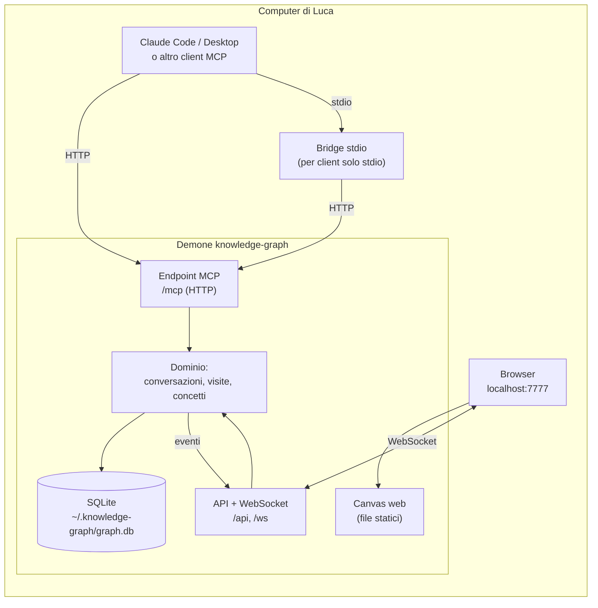

# Architettura di knowledge-graph

> Stato: architettura approvata il 2026-10-10 (D11). Sono implementati `kc_start`, `kc_track`, `kc_focus`, `kc_link`, `kc_move`, `kc_rename`, `kc_remove`, gli strumenti di lettura `kc_recall`, `kc_tree`, `kc_read`, `kc_search_graphs`, l'isolamento per grafo (D22), la skill per Claude Code, la vista conversazione, il grafo personale, le correzioni manuali con la ricerca e il pacchetto npm: il piano al §9 è completo. Il manuale per chi usa il prodotto è [MANUAL.md](MANUAL.md). Le decisioni di prodotto sono in DECISIONI.md del progetto.

## 1. Vincoli che guidano le scelte

- Locale, open source, installabile con un comando (RNF1–3).
- Qualunque client MCP deve poter scrivere e leggere (D6, RNF9).
- Il canvas si aggiorna in tempo reale mentre il modello scrive (RF11, RNF4).
- Nessuna chiave API o LLM lato server: l'intelligenza (titoli, testi dei nodi, "è lo stesso concetto?") la mette il modello che chatta. Il server è un archivio veloce e stupido.

## 2. Forma del sistema: un solo processo locale



**Perché un demone unico** e non un server MCP stdio lanciato da ogni client: più client (Claude Code in due terminali, Desktop) e il canvas devono vedere **lo stesso grafo, in tempo reale**. Un processo unico che possiede il database e notifica il browser è il modo più semplice. Per i client che parlano solo stdio c'è un bridge minimo che inoltra al demone (avviandolo se non gira). Il bridge confronta la propria versione con quella di `/api/health` (`{ok, version, pid}`): un demone più vecchio (o senza versione, di prima di questo controllo) viene fermato con `POST /api/shutdown` (arresto ordinato; in mancanza, segnale al pid, trovato con `lsof`/`netstat` per i demoni vecchi) e sostituito; uno più nuovo resta.

Alternativa scartata: ogni client avvia il suo server stdio e tutti scrivono sullo stesso file SQLite, con il canvas che osserva il file. Funziona, ma il tempo reale diventa polling e la logica si duplica.

## 3. Scelte tecnologiche

| Area | Scelta | Perché | Alternative |
|---|---|---|---|
| Linguaggio | **TypeScript su Node 22** | SDK MCP ufficiale maturo; stesso linguaggio per server e canvas; distribuzione con `npx`; coerente con LocalChat | Python + FastMCP (ottimo per MCP, ma due linguaggi e installazione meno immediata) |
| Server HTTP | **Fastify** | Leggero, già usato in LocalChat, WebSocket via plugin | Hono, Express |
| Persistenza | **SQLite** (WAL) + **FTS5** via `node:sqlite` | Un file = backup facile (RNF8); 10k concetti sono pochi; FTS5 per ricerca e concetti simili | Neo4j (troppo pesante per un tool locale), DB a grafo embedded (ecosistema fragile) |
| Somiglianza concetti (RF6) | **Lessicale** (FTS5 + nome normalizzato) | Zero dipendenze, decide comunque il modello | Embedding locali: in backlog se la lessicale non basta |
| Vista conversazione | **React + React Flow** con layout radiale (predefinito, spicchi proporzionali alle foglie, anelli allargati finché i nodi non si sovrappongono), mappa mentale (due layered **ELK** affiancati, bilanciati per foglie) o albero layered **ELK**; i collegamenti tratteggiati girano attorno ai nodi (percorso su griglia) | Nodi HTML ricchi: tooltip con "Approfondisci" banale; ≤500 nodi fluidi | Cytoscape.js |
| Vista personale | **Sigma.js** (WebGL) + layout force | 10k nodi fluidi (RNF7) | Cytoscape.js (unica libreria per entrambe, ma lenta oltre qualche migliaio) |
| Tempo reale | **WebSocket**, eventi dal dominio | Latenza < 1 s (RNF4) | SSE |
| Distribuzione | **pacchetto npm**: `npx knowledge-graph` | Un comando (RNF2) | Binario singolo, Docker |

**Pacchetto**: Node rifiuta il type stripping dentro `node_modules`, quindi il pacchetto pubblicato contiene JavaScript compilato. `npm run build` (lanciato da `prepare`, quindi anche a ogni `npm install` e nelle installazioni da GitHub) produce `dist/` con `tsc -p tsconfig.build.json` (`rewriteRelativeImportExtensions` riscrive gli import `.ts` in `.js`) e `web/dist/` con Vite; il comando `knowledge-graph` punta a `dist/server/cli.js`. In sviluppo si continua a eseguire `src/` direttamente. La CI installa il pacchetto impacchettato in una cartella vuota e verifica che il demone parta.
| Licenza | **MIT** | Permissiva, standard | Apache 2.0 |

## 4. Modello dati

```
conversations(id, title, client, started_at, last_activity_at)
concepts(id, name, name_norm UNIQUE, name_key, created_at, last_seen_at, visit_count)  -- name_key: quasi-duplicati
visits(id, conversation_id, concept_id, parent_visit_id NULL, title, summary, excerpt NULL, detail NULL, seq, created_at)
concept_links(from_concept_id, to_concept_id, kind)      -- kind "is_a" = superclasse (D18, una sola per concetto, i concetti senza visite sono ammessi), globale: si vede solo nel grafo globale
visits.ref_visit_id  -- nodo rimando (D25): il nodo gemello nell'altro grafo; concept_id punta a un concetto segnaposto nascosto (grafo globale, ricerca, conteggi lo escludono); titolo = titolo dell'altro grafo; POST /api/references crea la coppia, cancellarne uno cancella l'altro
map_relations(conversation_id, from_concept_id, to_concept_id, label, created_at)  -- relazione libera (tratteggiata) tra concetti diversi, per grafo (D22): nasce da kc_relate o dal canvas (POST /api/relations con conversationId) e si vede solo in quel grafo; il grafo globale mostra l'unione, una coppia una volta sola; si cancella con il grafo o con uno dei due concetti
fts_concepts(name, summaries)                            -- FTS5 per ricerca e somiglianza
revisions(target_kind, target_id, field, old_value, created_at)  -- valori precedenti a ogni modifica (D16), senza UI
sources(id, url UNIQUE, domain, first_seen)  -- fonti citate, una per URL normalizzato (niente utm_*, #frammento, / finale)
visit_sources(visit_id, source_id)  -- quali nodi citano quale fonte; una fonte che nessuno cita più viene cancellata
settings(key, value)                                     -- impostazioni varie (es. suggerimenti di raggruppamento ignorati); la "Memoria automatica" (D19) non c'è più
```

- **Albero della conversazione** = `visits` con `parent_visit_id`.
- **Collegamento tratteggiato** (D1) = due visite della stessa conversazione con lo stesso `concept_id`; sul nodo il badge "anche in" (D16).
- **Approfondisci** = tutte le visite del concetto, ciascuna con il padre e i figli come sezioni (D17). Aperto da un grafo (`/api/concepts/:id?conversation=`) mette per prime l'occorrenza di quel grafo, con le sue sole fonti e relazioni e senza superclasse; le altre stanno nella sezione chiusa "Anche in altri grafi" (D22).
- **Grafo personale** = `concepts` + archi derivati dalle visite (genitore → figlio) + `map_relations` (unione) + superclassi di `concept_links`.
- Il **testo di un nodo** è `summary` (1-2 frasi, l'etichetta) più `detail`: la parte della risposta su quel concetto, per intero e in markdown (D20; sempre disponibile, il modello la scrive in `kc_track`). Il testo di un concetto è la lista dei testi delle sue visite, più recente prima. Nessun LLM lato server.

## 5. Strumenti MCP (pochi e brevi, per il costo in token)

| Strumento | Fa | Requisiti |
|---|---|---|
| `kc_start(title?, resume?)` | Un titolo apre **sempre** un grafo nuovo e vuoto (niente ripresa per titolo uguale, niente elenco di grafi simili, niente profilo); `resume` (id o titolo) riprende un grafo esistente e, se non trova nulla, l'errore elenca al massimo 3 titoli vicini. Restituisce id e albero compatto | RF1, D22 |
| `kc_track(nodes[])` | **Batch**, chiamato **prima** di scrivere la risposta: crea una o più visite `{title, summary, parent, excerpt?}`. `parent` è obbligatorio (D15): titolo di un nodo della conversazione (ultima visita con quel titolo), `"root"`, oppure titolo o `"#n"` di un altro nodo della stessa chiamata, in qualsiasi ordine (il batch si elabora prima i padri, ordinamento topologico; un ciclo di padri è un errore). Il batch è atomico: con un errore non si scrive nulla e il risultato lo dice, chiedendo di richiamare `kc_track`. Stesso concetto sotto lo stesso padre aggiorna il testo invece di duplicare; in un altro ramo vale D1. Un figlio che riformula il padre (stesse parole, "Aspetti di X", "X" sotto "X e Y" che si prende tutto il ramo) viene rifiutato (D16). Restituisce `Graph: <titolo>` (si vede subito se scrive nel grafo sbagliato), l'albero compatto della conversazione (solo titoli) e al massimo 3 concetti simili per nodo, **solo tra quelli che hanno una visita in questo grafo** (prima i quasi-duplicati: plurali, articoli, ordine delle parole, colonna `concepts.name_key`); nessuna riga `Known:` | RF2, RF3, RF5, RF6 |
| `kc_focus(node_id)` | Torna su un nodo esistente (diventa il corrente) | RF4 |
| `kc_link(visit_id, concept_id)` | Conferma che una visita è un concetto già noto (unisce); il concetto di destinazione deve avere una visita in questo grafo | RF6, D22 |
| `kc_move(node, parent)` | Sposta un nodo (con i figli) sotto un altro nodo o alla radice, indicati per titolo o id; non unisce concetti | RF18 |
| `sources` in `kc_track` | URL delle ricerche web o dei documenti su cui si basa il nodo, solo quando la risposta li usa: il campo costa token solo in quelle chiamate. Massimo 10 per nodo, URL non validi ignorati, deduplica per URL normalizzato. `kc_recall` restituisce fino a 3 fonti per nodo; la pagina del concetto (Approfondisci) le elenca tutte, e dal pannello si possono togliere | Fonti (analisi/07) |
| `detail` in `kc_track` | Il testo pieno della risposta su quel nodo, in markdown; sempre esposto (D20) | D20 |
| `kc_rename(node, title)` | Rinomina un nodo; un titolo già usato da un altro concetto lo collega a quel concetto (D1) | D16 |
| `kc_remove(node)` | Elimina un nodo; i figli salgono al suo padre | D16 |
| `kc_relate(concept, superclass? / related_to?, label?)` | Raggruppa sotto una superclasse (solo su richiesta) o lega due concetti: entrambi devono avere una visita in questo grafo; la relazione appartiene a questo grafo | D18, D22 |
| `kc_recall(query)` | "Cosa dice già questo grafo su X?": solo nodi del grafo corrente | RF8, D22 |
| `kc_tree(summaries?, root?, depth?, relations?)` | Albero compatto del grafo corrente (senza `kc_start` è un errore, nessun "ultimo grafo") | RF9, D22 |
| `kc_read(node, graph?)` | Testo pieno di un nodo del grafo corrente; un titolo assente è l'errore "not in this graph". `graph` (id o titolo) legge un nodo di un altro grafo, solo dopo `kc_search_graphs` | D22 |
| `kc_reference(graph, parent?)` | Collega questo grafo a un altro con un nodo rimando ↗ (e il nodo di ritorno nell'altro): il modello lo propone in chat e lo chiama solo dopo il sì di Luca; dell'altro grafo vede solo il titolo | D25 |
| `kc_search_graphs(query)` | **L'unico strumento che guarda fuori dal grafo corrente**, solo su richiesta esplicita di Luca: gli altri grafi (il corrente è escluso), raggruppati per grafo, con titolo del grafo, titolo del nodo e riassunto accorciato; mai il `detail` | D22 |

Gli strumenti di lettura stanno in `src/core/reader.ts` (non scrivono mai) e rispondono in forma compatta:
- `kc_recall`: al massimo 5 nodi del grafo corrente `{title, parent?, summary, thin?, children?, sources?}` (riassunto accorciato, `thin` se senza `detail` né figli, fino a 3 fonti del nodo). Cerca per titolo esatto e, con l'indice FTS5 trigram, in titoli, riassunti e testi pieni dei soli nodi di quel grafo. Niente "visto altrove", vicini, membri o superclassi.
- `kc_search_graphs`: al massimo 20 nodi di altri grafi, raggruppati `{graph, id, nodes:[{title, summary}]}`.
- `kc_tree`: testo indentato, una riga per nodo con `*current`; i testi dei nodi solo con `summaries: true`. Solo il grafo della sessione.
- Il profilo del grafo globale (`Reader.profile()`) non è più uno strumento MCP.

Più un **prompt MCP** `kc_instructions` con le regole di tracciamento scritte in modo neutro rispetto al modello (quando creare un nodo, testo del nodo preso dalla risposta, una chiamata per turno). Per Claude Code c'è una skill pronta in `skills/knowledge-graph/SKILL.md`, installabile con `knowledge-graph install-skill` (copia in `~/.claude/skills/`). Le richieste "segna questo" / "non tracciare" (RF7) sono gestite dalle istruzioni, non servono strumenti dedicati.

## 6. Flussi chiave

1. **Tracciamento**: Luca chiede → il modello chiama una sola volta `kc_track` **prima** di scrivere la risposta (se la chiama dopo, Claude Desktop ripete la risposta), poi risponde senza mai annunciare la registrazione (lo ricordano le istruzioni, una nota breve nel risultato di `kc_start` e una in quello di `kc_track`) → il demone salva, aggancia i concetti, emette un evento → il canvas disegna i nodi.
2. **Hover**: il canvas ha già titolo e testo del nodo in memoria → tooltip immediato → "Approfondisci" chiama `/api/concepts/:id` → pannello con tutte le visite.
3. **Isolamento (D22)**: il grafo della chat è l'unico perimetro del modello. Il concetto resta globale (D1) perché il grafo globale mostri dove compare un tema, ma il testo è sulla visita e nessuno strumento legge visite di altri grafi tranne `kc_search_graphs` e `kc_read(node, graph)`, che Luca deve chiedere. Il modello non vede il grafo globale: le istruzioni (`src/server/instructions.ts`) non hanno più la regola "Memoria automatica" (D19, tolta insieme all'impostazione, al profilo di `kc_start` e al campo `memory`) ma una regola di perimetro. Per portare qualcosa da un altro grafo il modello lo riscrive con `kc_track`, con parole sue. La sessione MCP può sopravvivere alla chat (bridge stdio): per questo ogni risultato di `kc_track` apre con `Graph: <titolo>` e le istruzioni dicono di richiamare `kc_start` se il grafo non è quello della chat.
4. **Grafo personale**: la scheda "Grafo personale" chiama `/api/graph` (tutti i concetti con conteggio visite + archi pesati derivati dalle visite e da `concept_links`) → Sigma.js con layout ForceAtlas2; a ogni evento live ricarica e unisce i dati tenendo le posizioni dei nodi noti, così il disegno non salta. Per restare leggibile anche con migliaia di concetti: comunità calcolate nel browser con Louvain (`graphology-communities-louvain`) e disposte separate (`web/src/personal-layout.ts`), i concetti senza archi in una griglia a parte; da lontano una bolla per comunità con nome (il suo hub) e conteggio, da vicino i singoli concetti; etichette solo per i nodi grandi o vicini al puntatore, senza sovrapposizioni (griglia di Sigma più un passaggio anti-collisione); colore per comunità o per conversazione con legenda; filtri per conversazione, periodo, isolati e "solo concetti con fonti" (`sourceCount`). `/api/graph` restituisce per ogni concetto anche `conversationIds` e `sourceCount`, più l'elenco delle conversazioni.
5. **Correzione manuale** (D8, RF18): nel grafo globale, trascinando un concetto su una superclasse lo si raggruppa (`PATCH /api/concepts/:id/superclass`, la stessa operazione di "Raggruppa in…" e di `kc_relate`); nel pannello, dopo "Unisci a…" le risposte per un concetto non più aperto vengono ignorate. azione sul canvas → `/api` → regola in `Tracker` → evento su `/ws` → stesso aggiornamento visto da tutti. Dal pannello del concetto: rinomina (`PATCH /api/concepts/:id`; i nodi intitolati col vecchio nome lo seguono, un nome già preso va unito), unisci (`POST /api/concepts/:id/merge`), elimina (`DELETE /api/concepts/:id`, in tutte le conversazioni). Da "Modifica" sul nodo: titolo, genitore (mai sotto un proprio discendente), concetto collegato (`PATCH /api/visits/:id`), elimina (`DELETE /api/visits/:id`). Chi perde un nodo non perde i figli: salgono di un livello; un concetto rimasto senza visite sparisce.
6. **Ricerca** (RF17): casella in alto → `/api/search?q=` (nome esatto, poi nomi che contengono il testo, poi titoli e testi) → il concetto scelto si apre nel pannello, si evidenzia nell'albero e il grafo personale ci si centra.

7. **Esportazione come pagina web (D23)**: "⋯ → Esporta come pagina web" scarica `GET /api/conversations/:id/export.html[?layout=]`. `Reader.exportMap` assembla lo snapshot del solo grafo (albero e relazioni, posizioni salvate di quei nodi e relazioni, la pagina "Approfondisci" di ogni suo concetto ristretta a questo grafo: nessuna occorrenza altrui, superclassi e gruppi esclusi, più il layout in uso); `src/server/export.ts` prende `web/dist/index.html`, incorpora script e CSS (la build Vite ha un solo chunk, niente font né immagini, il worker di ELK nasce da un blob) e inserisce lo snapshot in `<script type="application/json" id="kg-snapshot">` (con `<` come `\u003c`), e la route aggiunge `Content-Disposition`. Segue il token del modo ospitato come ogni `/api`; senza build risponde 503. Nel canvas, `web/src/api.ts` legge l'elemento all'avvio: se c'è, `api` risponde dallo snapshot (la ricerca è fatta nel browser sui nodi del grafo), le scritture sono rifiutate, `subscribe` non apre il WebSocket e `READONLY` nasconde ogni modifica (schede, menu ⋯, trascinamento, collegamenti, modifica e menu del pannello). Un solo canvas, nessuna copia dei componenti.

## 7. Sicurezza e privacy

- Persistenza: SQLite in WAL; il demone fa il checkpoint ogni 10 s e alla chiusura, così `graph.db` da solo è sempre un backup completo (RNF8).
- Il demone ascolta solo su `127.0.0.1`; controllo dell'header `Origin` sull'endpoint MCP e sul WebSocket (protezione dal DNS rebinding, raccomandata dalle specifiche MCP).
- La pagina esportata contiene tutto il testo del grafo e chiunque abbia il file lo legge: non ha segreti né collegamenti al demone.
- Niente autenticazione nell'MVP, niente telemetria. I dati restano nel file SQLite; arrivano al modello solo quando lui li legge.

## 8. Rischi da verificare subito (spike)

- **Costanza del tracciamento**: quanto bene i modelli seguono le istruzioni senza essere ricordati. È il rischio principale: lo misuriamo per primo, con un prototipo minimo.
- **Trasporto per Claude Desktop**: verificare se si collega direttamente via HTTP locale o serve il bridge stdio (il bridge è previsto comunque).
- **Layout dell'albero mentre cresce**: i nodi non devono "saltare" a ogni inserimento (layout incrementale).

## 9. Piano di implementazione (dopo il tuo sì)

0. **Fondamenta**: repo GitHub, CLAUDE.md corto, CI con typecheck e test sulle PR, hook di avvio sessione.
1. **Spike del tracciamento**: demone + SQLite + `kc_start` / `kc_track` + vista albero grezza. Si prova in una conversazione vera con Claude Code.
2. **Canvas conversazione**: React Flow, layout ELK, tempo reale, tooltip con "Approfondisci", nodo corrente, collegamenti tratteggiati.
3. **Grafo personale**: vista Sigma.js, aggancio dei concetti, `kc_link`.
4. **Lettura**: `kc_recall`, `kc_tree`, `kc_read`, prompt di istruzioni e skill per Claude Code.
5. **Correzioni manuali** (D8) e ricerca (RF17).
6. **Pacchetto npm**, README, manuale di architettura leggero.
